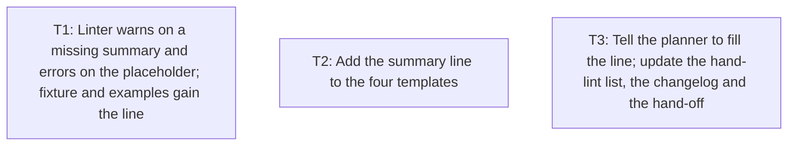

# Plan: every note ship-better-plans writes carries a one-line `summary:`

## Summary
The four note templates and three example plans shipped with `ship-better-plans` have no `summary:` line in their frontmatter, so every plan, decision, open question and instruction the skill writes is indexed by its title and makes `ship-agent-context`'s `check` warn. This plan adds the line to the seven files with the placeholder `` `<one-line summary>` ``, has step 5 of the skill tell the planner to fill it, and extends `lint_plan.py` so a plan with no summary gets a warning and a plan with the placeholder left in gets an error, with unit tests for both. The biggest risk is the new warning breaking the two existing tests that assert zero warnings, so one task changes the linter, its fixture and the three examples together and every commit leaves the suite green. Done when the linter tests, the skill validator, the link checker, markdownlint and the notes check all pass, the template's placeholder is caught by the linter, and the hand-off note no longer lists the gap.

## Context
- **Problem:** `ship-agent-context` 1.3 builds `docs/agent/MANIFEST.md` from each note's `summary:` line and its `check` warns for notes that have none. `ship-better-plans` writes notes from templates that lack the line, and its examples show plans without it, so the planner never learns to write one.
- **Why now:** the skills refresh on this branch is at 12 of 12 and the hand-off lists this as the one open item between the two skills.
- **Request:** "Every plan, decision, open-question and instruction note that ship-better-plans writes should carry a one-line `summary:` in its frontmatter, because ship-agent-context 1.3 builds docs/agent/MANIFEST.md from that line and its `check` warns when it is missing. Add the line to the four templates under skills/ship-better-plans/templates/ and to the three example plans under skills/ship-better-plans/examples/, have SKILL.md (or the reference the plan-writing step points to) tell the planner to fill it, keep the plan linter and its tests passing (extend the linter to warn when a plan has no summary line if that is cheap), and keep the plugin symlinks and validate-skills.py happy. This is a real change in this repository; nobody is available to answer questions, so record assumptions and run the standard review."

## Success criteria
- SC-1: each of the four templates and the three example plans carries a `summary:` line in its frontmatter (stated by the user).
- SC-2: the skill text tells the planner to fill the line when it starts a plan (stated by the user).
- SC-3: `lint_plan.py` warns when a plan's frontmatter has no `summary:` line or an empty one, errors when the template placeholder is left in it, and its test suite passes with tests for both (stated by the user, "if cheap"; it is two lines plus a regex extension).
- SC-4: `validate-skills.py`, `check-skill-links.py`, markdownlint and the `ship-agent-context` notes check pass after the change (stated by the user, "keep the plugin symlinks and validate-skills.py happy").

## Non-goals
- Migrating the templates to the minimal 1.3 frontmatter (dropping `author`, `tags`, `importance`, or changing `source: user-instruction`). `ship-agent-context` ignores the older fields, so nothing is broken by leaving them. Follow-on if wanted.
- Adding `summary:` to notes already in `docs/agent/` (all of them have one: the notes check reports 0 warnings).
- Making a missing summary a linter error. The user asked for a warning, and `ship-agent-context` itself only warns.
- Fixing the sentence in `SKILL.md` that says a draft plan's index entry "starts with DRAFT" (the index appends `*(draft)*` instead). Out of the request; noted for a follow-on.
- A version bump of the plugin (see A-1).

## Constraints
- Source of truth is `skills/ship-better-plans/`; `plugins/ship-better-plans/skills/ship-better-plans/` holds one symlink per top-level entry and the validator fails if they differ (F-13). No task adds or removes a top-level entry, so no symlink changes.
- `lint_plan.py` is standard-library Python and must keep running on an old `python3` (the hand-off says macOS ships 3.9).
- The bundled examples are linted in CI with `--no-paths` and the unit tests require them to produce zero warnings (F-10, F-11).
- Every task's commit must leave the test suite green, because `ship-execute` reverts a commit whose own `Verify` fails and runs the test command after each wave (F-18).
- Standing instructions in `docs/agent/instructions/`: no Claude attribution lines in commit messages; no push and no pull request without being asked.
- `docs/agent/MANIFEST.md` is generated; rebuild it with `agent_context.py index`, never edit it by hand.

## Facts and assumptions
- F-1: the index reads a note's `summary` and falls back to its title — `skills/ship-agent-context/scripts/agent_context.py:244`
- F-2: `check` collects notes without `summary:` and warns, naming them — `skills/ship-agent-context/scripts/agent_context.py:974` and `skills/ship-agent-context/scripts/agent_context.py:991`
- F-3: the index renders each entry as the summary followed by the plan's `approval` state and any non-active status in italics — `skills/ship-agent-context/scripts/agent_context.py:269` to `skills/ship-agent-context/scripts/agent_context.py:273`
- F-4: what a summary should say: one line, what the reader should do or know, durable facts — `skills/ship-agent-context/reference.md:23`; older fields such as `importance`, `tags` and `author` are tolerated and ignored — `skills/ship-agent-context/reference.md:29`
- F-5: the plan template's frontmatter runs from `type:` to `base:` with no `summary:` — `skills/ship-better-plans/templates/plan.md:2` to `skills/ship-better-plans/templates/plan.md:11`; its placeholders are written as `<agent-id>` and `<branch>@<short-sha>` — `skills/ship-better-plans/templates/plan.md:7`
- F-6: the decision, open-question and instruction templates likewise have no `summary:` — `skills/ship-better-plans/templates/decision.md:8`, `skills/ship-better-plans/templates/open-question.md:9`, `skills/ship-better-plans/templates/instruction.md:10` (the last frontmatter key of each)
- F-7: the three examples have no `summary:` — ran: `head -n 16` on `skills/ship-better-plans/examples/example-plan-small.md`, `example-plan-feature.md`, `example-plan-refactor.md` → frontmatter keys are type, status, approval, created, updated, author, tags, importance, plan_format, base
- F-8: the linter parses frontmatter into a dict, splitting each line on its first colon — `skills/ship-better-plans/scripts/lint_plan.py:130` to `skills/ship-better-plans/scripts/lint_plan.py:140`; reads `approval` from it — `skills/ship-better-plans/scripts/lint_plan.py:367`; and warns when it is missing — `skills/ship-better-plans/scripts/lint_plan.py:389`
- F-9: the placeholder check runs over every line including the frontmatter, with inline code masked, and the `<…>` pattern lists `branch`, `short-sha` and `agent-id` — `skills/ship-better-plans/scripts/lint_plan.py:92` and `skills/ship-better-plans/scripts/lint_plan.py:381`
- F-10: the test fixture plan has no `summary:` — `skills/ship-better-plans/tests/test_lint_plan.py:21` to `skills/ship-better-plans/tests/test_lint_plan.py:26`; the clean-plan test asserts `0 warning(s)` — `skills/ship-better-plans/tests/test_lint_plan.py:119`; the examples test asserts `0 error(s), 0 warning(s)` — `skills/ship-better-plans/tests/test_lint_plan.py:142`; an existing test runs the linter twice in one test — `skills/ship-better-plans/tests/test_lint_plan.py:206` to `skills/ship-better-plans/tests/test_lint_plan.py:215`
- F-11: CI runs the linter tests and lints each example with `--no-paths` — `.github/workflows/validate.yml:164` and `.github/workflows/validate.yml:204`
- F-12: step 5 of the skill tells the planner to start from the template — `skills/ship-better-plans/SKILL.md:93`; the "What gets written" section says the templates follow the `ship-agent-context` conventions — `skills/ship-better-plans/SKILL.md:186`; the hand-lint list says what the frontmatter must say — `skills/ship-better-plans/reference-cards.md:112`; the word "summary" already appears once elsewhere in the skill text — `skills/ship-better-plans/SKILL.md:139`
- F-13: the validator requires every top-level entry of `skills/<name>/` to have a symlink under the plugin — `scripts/validate-skills.py:469` to `scripts/validate-skills.py:486`; its enforced cap on `SKILL.md` is 800 lines — `scripts/validate-skills.py:105`; ran: `ls` on both directories → the same eight entries
- F-14: the changelog's unreleased `ship-better-plans` 2.0.0 entry has a linter bullet and a docs bullet — `CHANGELOG.md:14` and `CHANGELOG.md:16`; the plugin is at 2.0.0 — `plugins/ship-better-plans/.claude-plugin/plugin.json:4` and `.claude-plugin/marketplace.json:39`
- F-15: baseline, all run from the repository root on 2026-10-22 before this plan file existed: ran: `python3 -m unittest discover -s skills/ship-better-plans/tests` → 43 tests OK; ran: `python3 scripts/validate-skills.py` → all checks passed; ran: `python3 scripts/check-skill-links.py` → 154 files, all links resolve; ran: `npx --yes markdownlint-cli2` → 0 issues in 301 files; ran: `python3 skills/ship-agent-context/scripts/agent_context.py check` → 55 notes, 0 errors, 0 warnings (56 notes once this plan is counted)
- F-16: `agent_context.py` refuses to write only when a CI environment variable is set — `skills/ship-agent-context/scripts/agent_context.py:98` to `skills/ship-agent-context/scripts/agent_context.py:103`; its leftover-template check searches the whole file (`skills/ship-agent-context/scripts/agent_context.py:937` and `skills/ship-agent-context/scripts/agent_context.py:945`) but its templates hold body sections only (`skills/ship-agent-context/scripts/agent_context.py:64` to `skills/ship-agent-context/scripts/agent_context.py:74`) and `new` fills `summary:` from `--summary` or the title (`skills/ship-agent-context/scripts/agent_context.py:835`), so the `<one-line summary>` text matches nothing it looks for; `index --check` reports whether the index matches the notes without writing — `skills/ship-agent-context/scripts/agent_context.py:302` to `skills/ship-agent-context/scripts/agent_context.py:307`
- F-17: the hand-off records that the templates lack the line, as the last sentence of the `ship-agent-context` item — `docs/agent/status/ship-skills-refresh-handoff.md:95`; its `updated:` date is in the frontmatter — `docs/agent/status/ship-skills-refresh-handoff.md:5`; the agent-context audit says the same — `docs/agent/investigations/ship-agent-context-refresh-audit.md:89`
- F-18: `ship-execute` reverts a task commit whose `Verify` fails when it re-runs it — `skills/ship-execute/SKILL.md:106`; and runs the plan's test command after each parallel wave — `skills/ship-execute/SKILL.md:108`
- A-1: no version bump; the change is folded into the unreleased 2.0.0 changelog entry. Evidence: ran: `git show --stat ada999a` (a post-refresh edit to `ship-execute`) → CHANGELOG.md and two SKILL.md files changed, no plugin.json. If wrong: the user wants 2.1.0 — settled by: the user; the fix is the version in `plugins/ship-better-plans/.claude-plugin/plugin.json` and `.claude-plugin/marketplace.json` plus a changelog line.
- A-2: the summary texts chosen for the three examples (given in T1) read well enough; nobody was available to approve the wording. If wrong: the examples teach a poorer summary — settled by: the user, by editing the three lines.

## Approach
| Option | Meets the success criteria? | Effort | Main risk | Reversibility | Verdict |
|--------|-----------------------------|--------|-----------|---------------|---------|
| A: add the line to the seven files, one sentence in step 5, a warning and a placeholder error in the linter with tests, amend the unreleased changelog entry and the hand-off | SC-1 to SC-4 | S | the new warning breaks the two zero-warning tests unless the fixture and the examples change in the same commit | safe: revert | chosen |
| B: same as A without touching the linter; rely on `ship-agent-context`'s `check` | SC-1, SC-2, SC-4; not SC-3 | S | a plan written where `docs/agent/` has no check is indexed by title and nobody notices | safe | rejected because the user asked for the warning if cheap, and it is two lines plus a regex extension beside the existing `approval` warning (F-8, F-9) |
| C: A plus migrate the templates to the 1.3 frontmatter (drop `author`, `tags`, `importance`; `source: user`) | SC-1 to SC-4, plus tidier notes | M | changes the examples' frontmatter beyond the request and the executor's `base` and `plan_format` rows in reference-cards would need rereading | safe | rejected because the older fields are tolerated (F-4) and the request names the one line to add |

- **Chosen:** A — **deciding factor:** it is the whole request and nothing beyond it, and every piece is checked by a test or a check that already runs in CI.
- **Builds on:** the linter's existing frontmatter parse and `approval` warning (`skills/ship-better-plans/scripts/lint_plan.py:367`, `skills/ship-better-plans/scripts/lint_plan.py:389`), its `<…>` placeholder pattern (`skills/ship-better-plans/scripts/lint_plan.py:92`), and the tests' `GOOD_PLAN` fixture (`skills/ship-better-plans/tests/test_lint_plan.py:20`).

## Risks and rollback
| Risk | Why it matters | Handled by | How we would notice |
|------|----------------|------------|---------------------|
| The new warning fires on the fixture plan and the examples, so two existing tests fail | CI goes red, and `ship-execute` reverts a commit whose suite is red (F-18) | T1 changes the linter, the fixture and the three examples in one task, so no commit leaves the suite red | `python3 -m unittest discover -s skills/ship-better-plans/tests` fails |
| A decision, open-question or instruction note written with the placeholder left in is not caught by any check (the linter reads plans only; `check`'s templates carry no summary line, F-16) | the index shows `<one-line summary>` for that note | accepted by the planner: the placeholder is visible in the index and `find`, and the skill text (T3) tells the planner to fill it | reading `docs/agent/MANIFEST.md` |
| The sentences added to `SKILL.md` push it over the validator's line cap | validator fails | it is 192 lines against an enforced cap of 800 (F-13) | `python3 scripts/validate-skills.py` |

- **Rollback:** revert the task commits, then run `python3 skills/ship-agent-context/scripts/agent_context.py index` so the generated index matches the notes again. No data, configuration or other generated file changes.
- **Migration:** N/A — no live data, state or schema changes.

## Specification

### Requirements
- FR-1: each of `templates/plan.md`, `templates/decision.md`, `templates/open-question.md` and `templates/instruction.md` has the frontmatter line `summary: <one-line summary>` (the angle-bracket form the templates already use for `author` and `base`, F-5) (SC-1)
- FR-2: each of the three example plans has a filled `summary:` line that states what the plan builds and how, in the form `ship-agent-context` asks for (F-4) (SC-1)
- FR-3: step 5 of `SKILL.md` tells the planner to fill `summary:` with one line and why (`ship-agent-context` builds the index from it and its `check` warns when it is missing), and the "What gets written" section says every note written from the templates carries the line (SC-2)
- FR-4: `lint_plan.py` reports a STRUCTURE warning when the frontmatter has no `summary:` or its value is empty, no warning for a filled or quoted summary, and a STRUCTURE error when the `<one-line summary>` placeholder is left in, by adding `one-line summary` to the existing `<…>` placeholder pattern (SC-3)
- FR-5: the linter tests cover the missing, empty, quoted and placeholder cases, and the fixture plan and bundled examples still lint with zero warnings (SC-3)
- FR-6: the hand-lint list in `reference-cards.md` and the unreleased changelog entry describe the summary line and the new linter checks; the hand-off note no longer lists the gap as open; the plugin version stays 2.0.0 (A-1) (SC-2, SC-4)

### Acceptance criteria
- AC-1 (FR-1): `grep -c '^summary: <one-line summary>$' skills/ship-better-plans/templates/plan.md skills/ship-better-plans/templates/decision.md skills/ship-better-plans/templates/open-question.md skills/ship-better-plans/templates/instruction.md` — verify: each file reports 1
- AC-2 (FR-2): `grep -c '^summary: ' skills/ship-better-plans/examples/example-plan-small.md skills/ship-better-plans/examples/example-plan-feature.md skills/ship-better-plans/examples/example-plan-refactor.md` — verify: each file reports 1, and the line has no angle brackets
- AC-3 (FR-3): `grep -n 'summary:' skills/ship-better-plans/SKILL.md` — verify: exactly two hits, one inside step 5 and one inside "What gets written", each naming `ship-agent-context` as the reader of the line (the existing "the summary," at line 139 has no colon and does not match)
- AC-4 (FR-4): the named test `test_missing_summary_is_a_warning` — verify: it passes, and it runs the linter three times on the fixture plan: with the `summary:` line removed and with the line replaced by a bare `summary:`, asserting exit code 0 and `frontmatter has no `summary:` line` in the output both times; and with `summary: "A helper: used by main"`, asserting `0 warning(s)`
- AC-5 (FR-4): the named test `test_summary_placeholder_left_in` — verify: it passes, asserting exit code 1 and `placeholder <template placeholder>` in the output when the fixture's summary value is `<one-line summary>`
- AC-6 (FR-5): `python3 -m unittest discover -s skills/ship-better-plans/tests` — verify: 45 tests pass, including `test_clean_plan_passes` and `test_bundled_examples_pass` with their zero-warning assertions unchanged
- AC-7 (FR-6, SC-4): `python3 scripts/validate-skills.py`, `python3 scripts/check-skill-links.py`, `npx --yes markdownlint-cli2`, `python3 skills/ship-agent-context/scripts/agent_context.py check` and `python3 skills/ship-agent-context/scripts/agent_context.py index --check` — verify: each exits 0 with 0 errors and 0 warnings (the note count is the baseline in F-15 plus this plan); `grep -n 'frontmatter `summary:`' CHANGELOG.md` → one hit in the 2.0.0 linter bullet; `grep -n 'summary:' skills/ship-better-plans/reference-cards.md` → one hit in item 1 of "Lint by hand"; `grep -n 'summary' docs/agent/status/ship-skills-refresh-handoff.md` → the rewritten open item says the templates and examples carry the line

### Non-functional targets
N/A — a documentation and linter change with no runtime behaviour.

### Interfaces and data shapes
- **Frontmatter line (templates):** exactly `summary: <one-line summary>`, placed after `updated:` so it sits where `ship-agent-context`'s own `new` puts it (`skills/ship-agent-context/reference.md:15`). The placeholder string is the contract between T2 and T1: the linter's placeholder pattern becomes `<(?:branch|short-sha|agent-id|one-line summary)>` and reports it as `placeholder <template placeholder>` like the others. The Final check lints the template itself to show the two agree.
- **Frontmatter line (filled):** `summary: <text>`, one line, no angle brackets; double-quote it when it contains a colon followed by a space (the linter splits on the first colon only, F-8).
- **Linter output:** `WARN  [STRUCTURE] frontmatter has no `summary:` line; ship-agent-context indexes the plan by its title and its check warns` (exit 0 when nothing else is wrong); the placeholder case is the existing `ERROR [STRUCTURE] line N: placeholder <template placeholder> left in the plan` (exit 1).

### Edge cases
| Case | Expected behaviour | Covered by |
|------|--------------------|------------|
| `summary:` line absent | the warning | AC-4, first run of `test_missing_summary_is_a_warning` |
| `summary:` present but empty | the warning | AC-4, second run of `test_missing_summary_is_a_warning` |
| Summary quoted because it holds a colon | no warning (F-8) | AC-4, third run of `test_missing_summary_is_a_warning`; and the Final check lints this plan, whose summary is quoted |
| Plan with no frontmatter at all | both the existing `approval` warning and the new `summary` warning, from the same empty dict (F-8) | out of scope for a test because removing the frontmatter also triggers the `approval` warning and muddies the assertion; reasoned from F-8 |
| Folded multi-line summary (`summary: >`) | not warned: the parser sees `>` as a non-empty value | out of scope because the index wants one line (F-4) and no template or example uses the form |
| Placeholder left in a decision, open-question or instruction note | not caught by the linter (plans only) | out of scope because `check`'s templates carry no summary line to match (F-16); accepted in Risks |
| Fixture plan and examples after the warning is added | zero warnings | AC-6 |

## Verification
- **Setup:** a checkout with `python3` and `npx`; nothing to install.
- **Commands:** test `python3 -m unittest discover -s skills/ship-better-plans/tests` · lint `python3 scripts/validate-skills.py`, `python3 scripts/check-skill-links.py`, `npx --yes markdownlint-cli2`, `python3 skills/ship-agent-context/scripts/agent_context.py check` — defined in `.github/workflows/validate.yml` and in the hand-off's list of checks that must pass before committing
- **Baseline:** F-15 (all green on 2026-10-22)
- **Final check:** SC-1 by AC-1 and AC-2; SC-2 by AC-3; SC-3 by AC-4, AC-5 and AC-6; SC-4 by AC-7. Then two runs that exercise the change end to end: `python3 skills/ship-better-plans/scripts/lint_plan.py skills/ship-better-plans/templates/plan.md --no-paths | grep -c 'placeholder <template placeholder>'` → 3 (today it is 2, for `author:` and `base:`; the third is the summary line, which proves the template's text and the linter's pattern agree); and `python3 skills/ship-better-plans/scripts/lint_plan.py docs/agent/plans/ship-better-plans-summary-line.md --repo .` → no `summary:` warning (a real quoted summary passes). All run by the executor; nothing needs a person or another environment.

## Tasks

### Conventions for every task
- Run every command from the repository root.
- Commit messages follow the branch's style (`ship-better-plans: <what changed>`), with no Co-Authored-By or other Claude attribution lines (`docs/agent/instructions/no-claude-attribution-in-commits.md`). Do not push and do not open a pull request.
- Do not add, rename or remove a top-level entry under `skills/ship-better-plans/`; the plugin symlinks mirror them one to one and the validator fails otherwise.
- `lint_plan.py` stays standard-library only and compatible with Python 3.9 (no `match` statements, no `str.removeprefix` in new code).
- Write the placeholder in prose and tests only inside backticks or a string literal; the linter treats the bare text as an error once T1 lands.
- Every commit leaves `python3 -m unittest discover -s skills/ship-better-plans/tests` green.

### T1 — Linter warns on a missing summary and errors on the placeholder; fixture and examples gain the line
- **Depends on:** none
- **Covers:** FR-2, FR-4, FR-5, AC-2, AC-4, AC-5, AC-6
- **Files:** `skills/ship-better-plans/scripts/lint_plan.py` (modify), `skills/ship-better-plans/tests/test_lint_plan.py` (modify), `skills/ship-better-plans/examples/example-plan-small.md` (modify), `skills/ship-better-plans/examples/example-plan-feature.md` (modify), `skills/ship-better-plans/examples/example-plan-refactor.md` (modify)
- **Do:** One commit, so the suite is never red. In `lint_plan.py`, after the `approval` warning at line 389, add: if `meta.get("summary", "").strip()` is empty, `report.warn("STRUCTURE", "frontmatter has no `summary:` line; ship-agent-context indexes the plan by its title and its check warns")`. Extend the `<…>` entry of `ANYWHERE_PLACEHOLDERS` (line 92) to `<(?:branch|short-sha|agent-id|one-line summary)>` so a left-in placeholder is reported as the existing `placeholder <template placeholder> left in the plan` error. Add `summary:` to the STRUCTURE line of the module docstring (lines 11 to 13). In `test_lint_plan.py`, add the line `summary: A greeting helper used by the entry point` to `GOOD_PLAN`'s frontmatter after `created:` (line 25), then add two tests to the `Structure` class. `test_missing_summary_is_a_warning` calls `run_linter` three times, the way `test_hard_to_reverse_task_needs_a_gate` does: with the summary line removed, and with it replaced by a bare `summary:`, asserting exit code 0 and that `frontmatter has no `summary:` line` is in the output both times; then with it replaced by `summary: "A helper: used by main"`, asserting exit code 0 and `0 warning(s)` in the output. `test_summary_placeholder_left_in` replaces the line's value with `<one-line summary>`, asserts exit code 1 and that `placeholder <template placeholder>` is in the output. Leave every other test and the zero-warning assertions unchanged. In each example's frontmatter insert one `summary:` line after `updated:` (line 6), unquoted, with exactly this text. Small: `summary: Add a --json flag to the report command as a second renderer beside the table; the default output is unchanged`. Feature: `summary: Per-tenant API rate limiting with a Redis sliding window behind a feature flag; fails open and alerts when Redis is down`. Refactor: `summary: Extract the payment-provider calls from OrderService into a PaymentGateway module one operation at a time behind characterization tests`. Each restates the example's own Summary section in one line, as `ship-agent-context` asks (what the plan builds and how). Change nothing else in the examples.
- **Verify:** `python3 -m unittest discover -s skills/ship-better-plans/tests` → 45 tests pass, including the two new tests, `test_clean_plan_passes` and `test_bundled_examples_pass`
- **Kind:** code · **Size:** S · **Reversibility:** safe

### T2 — Add the summary line to the four templates
- **Depends on:** none
- **Covers:** FR-1, AC-1
- **Files:** `skills/ship-better-plans/templates/plan.md` (modify), `skills/ship-better-plans/templates/decision.md` (modify), `skills/ship-better-plans/templates/open-question.md` (modify), `skills/ship-better-plans/templates/instruction.md` (modify)
- **Do:** In each template's frontmatter, insert the line `summary: <one-line summary>` directly after the `updated: YYYY-MM-DD` line (plan.md line 6, decision.md line 5, open-question.md line 5, instruction.md line 5). Change nothing else: the other placeholder fields, the body sections and the comments stay as they are. The angle-bracket form matches the templates' existing `author: <agent-id>` placeholder and is what the linter (T1) recognises; the Final check lints the plan template to show the two agree.
- **Verify:** `grep -c '^summary: <one-line summary>$' skills/ship-better-plans/templates/plan.md skills/ship-better-plans/templates/decision.md skills/ship-better-plans/templates/open-question.md skills/ship-better-plans/templates/instruction.md` → each reports 1; `npx --yes markdownlint-cli2` → 0 issues
- **Kind:** docs · **Size:** S · **Reversibility:** safe

### T3 — Tell the planner to fill the line; update the hand-lint list, the changelog and the hand-off
- **Depends on:** none
- **Covers:** FR-3, FR-6, AC-3, AC-7
- **Files:** `skills/ship-better-plans/SKILL.md` (modify), `skills/ship-better-plans/reference-cards.md` (modify), `CHANGELOG.md` (modify), `docs/agent/status/ship-skills-refresh-handoff.md` (modify), `docs/agent/MANIFEST.md` (modify)
- **Do:** In `SKILL.md` step 5 (line 93), after the sentence that starts the plan file from the template, add: "Fill the frontmatter `summary:` with one line that says what the plan builds and how; `ship-agent-context` builds `docs/agent/MANIFEST.md` from that line and its `check` warns when it is missing." In the "What gets written" section (line 186), after "follow the `ship-agent-context` conventions", add: "every note written from them carries a one-line `summary:`, which is what the index and `find` show." In `reference-cards.md` item 1 of "Lint by hand" (line 112), extend the last sentence to: "The frontmatter says `approval: draft` or `approved` and carries a one-line `summary:`." In `CHANGELOG.md`, in the unreleased `ship-better-plans` 2.0.0 entry: add to the linter bullet (line 14) "a plan with no frontmatter `summary:` line (warning) or with the template placeholder left in it (error)", change "43 unit tests" to "45 unit tests" on line 14 only (the same phrase on line 82 belongs to `ship-vuln-fix` and must not change), and add to the docs bullet (line 16) "templates and examples carry the `summary:` line that `ship-agent-context` 1.3 indexes". In `docs/agent/status/ship-skills-refresh-handoff.md`, rewrite the last sentence of the `ship-agent-context` item (line 95, "`ship-better-plans`' own note templates still lack a `summary:` line") to say that the templates and examples carry a `summary:` line and `lint_plan.py` warns when a plan has none, and set `updated:` (line 5) to the date of the change; then run `python3 skills/ship-agent-context/scripts/agent_context.py index` so the generated index reflects the edited note, and commit the regenerated `docs/agent/MANIFEST.md` with it. Leave the plugin version at 2.0.0 (A-1).
- **Verify:** `python3 scripts/validate-skills.py` → all checks passed; `python3 scripts/check-skill-links.py` → all links resolve; `npx --yes markdownlint-cli2` → 0 issues; `python3 skills/ship-agent-context/scripts/agent_context.py check` → 0 errors, 0 warnings; `python3 skills/ship-agent-context/scripts/agent_context.py index --check` → "MANIFEST.md is up to date."; `grep -n 'summary:' skills/ship-better-plans/SKILL.md` → exactly two hits (step 5 and "What gets written"); `grep -c '43 unit tests' CHANGELOG.md` → 1 and `grep -n '45 unit tests' CHANGELOG.md` → one hit, on the `ship-better-plans` linter bullet
- **Kind:** docs · **Size:** S · **Reversibility:** safe

### Execution order

- Wave 1: T1, T2, T3 (can run in parallel)
- Critical path: T1

## Open questions
- OQ-1 (non-blocking): should the plugin version move to 2.1.0 for this change? — default if unanswered: no, per A-1; the 2.0.0 entry is still unreleased and the branch's earlier post-refresh edits did the same.

## Audit
Standard depth, run unattended on 2026-10-22 through the audit workflow (9 agents): reviewers `executor`, `grounding`, `adversary`, `scope`, and `tests` (chosen by the script because the plan's proof rests on the linter suite). 10 findings raised, 7 after merging, 2 verified.

- **Confirmed, major (executor, also adversary and scope):** T1 as first written expected its own `Verify` to fail until a later task added the examples' summaries, and `ship-execute` reverts a commit whose `Verify` fails and runs the suite after each wave (F-18). Fixed: the three example edits moved into T1, the old T3 was dropped, every task is in one wave, and a convention says every commit leaves the suite green.
- **Confirmed, minor (tests):** the empty-summary and quoted-summary cases were claimed as covered but no test exercised them. Fixed: `test_missing_summary_is_a_warning` runs three cases (absent, empty, quoted with a colon), the edge-case rows point at it, and the Final check lints this plan. The no-frontmatter case stays reasoned from F-8, as the verifier suggested.
- **Minor (executor, tests):** the greps on the bare word "summary" matched pre-existing lines. Fixed: AC-3, AC-7 and T3 grep for `summary:` and for the exact changelog phrase, with the expected hit counts.
- **Minor (grounding):** the hand-off note still listed the gap as open and no task updated it. Fixed: T3 rewrites that line, bumps `updated:`, rebuilds the index and owns `docs/agent/MANIFEST.md`.
- **Minor (grounding):** this plan's own frontmatter had `status: draft` beside `approval: draft` (the index showed `*(draft, draft)*`), its summary began "DRAFT, unattended:", and F-15's note count predated the plan. Fixed: `status: active`, a durable summary, counts restated.
- **Minor (scope):** two line caps quoted for `SKILL.md`. Fixed: 800, the enforced cap, in both places.
- **Minor (tests):** the Final check's index step could pass before any task ran. Fixed: replaced by linting the plan template (the placeholder error proves T2's text and T1's pattern agree) and linting this plan.

Nothing disputed, nothing unverified, no reviewer failed. Not covered: the `security`, `data` and `ops` lenses were not selected (no attack surface, data or deployment in the change).

**Recheck** (one `revision` reviewer, the single recheck a full review allows): six of the seven prior findings resolved; the Final check replacement was unresolved because linting the unchanged template already reports a placeholder at line 7. Fixed: the Final check now counts placeholder hits in the template (2 today, 3 after T1 and T2). Three new minors, all fixed: the changelog phrase "43 unit tests" also appears on the `ship-vuln-fix` line, so T3 names line 14 only and verifies the count; F-16 gave the wrong reason why `check` misses a placeholder summary (its templates carry no summary line; the search is not body-only), reworded with the Risk and Edge-case rows. No further review was run.

## Status
Draft, written unattended on 2026-10-22: no checkpoint and no approval question were asked. Assumptions not confirmed by anyone: A-1 (no version bump) and A-2 (the wording of the three example summaries). This plan and the regenerated `docs/agent/MANIFEST.md` are uncommitted. Next: the user reads the plan, rules on OQ-1, then builds it with `/ship-execute docs/agent/plans/ship-better-plans-summary-line.md` or asks for changes.

**2026-10-22, executed by `ship-execute` (claude-fable-5-1), unattended.** Nothing is still to be shown elsewhere: every check in the Final check runs locally and all of them passed. Branch `ship/ship-better-plans-summary-line` from `be2ee2b`; commits `4c407ea` (this plan and the rebuilt index), `f6af6e0` (T1), `ef4fed9` (T2), `74f74cd` (T3), then the commit recording this entry. All three tasks `done`, each checked against its card and its `Verify` run on the branch: T1 45 tests OK; T2 each template reports 1, markdownlint 0 issues; T3 validator, links, markdownlint, notes check (56 notes, 0 errors, 0 warnings) and `index --check` all pass, the greps give the expected hits. Final check: AC-1 to AC-7 met; linting the plan template reports 3 `<template placeholder>` errors (was 2); linting this plan gives no `summary:` warning.

- Deviations: (a) the tasks were built one at a time directly on the execution branch, not in worktrees: the harness cut the wave's worktrees from `be2ee2b` instead of the branch tip, so all three isolated agents stopped before changing anything; the check-then-verify-on-the-branch acceptance was unchanged. (b) T3's `index` rebuild produced no diff, because the hand-off's `summary:` line did not change, so `docs/agent/MANIFEST.md` is not in T3's commit. (c) The index was rebuilt in the plan commit `4c407ea`: the baseline notes check failed on the index left stale when this plan was marked approved.
- Corrections the run revealed: F-8's line numbers for `lint_plan.py` are off by one after T1's docstring line (`lint_plan.py` on this plan now warns that `:130` is a blank line); they were right at the plan's base and are left as written.
- Review: one independent reviewer with `ship-clean-code`, no blocking findings. Follow-on if wanted: a quoted empty value (`summary: ""`) is not warned, because the parser keeps the quotes; outside this request.
- Still open: the version question (OQ-1); the version is left at 2.0.0 per A-1. Nothing pushed, no pull request opened.

## Related
- [ship-skills-refresh-handoff](../status/ship-skills-refresh-handoff.md) — lists this gap as the open item between `ship-better-plans` and `ship-agent-context`; T3 closes that item
- [ship-agent-context-refresh](../decisions/ship-agent-context-refresh.md) — C4: the index is generated from each note's `summary`
- [ship-better-plans-v2-refresh](../decisions/ship-better-plans-v2-refresh.md) — the 2.0 rewrite this change extends
